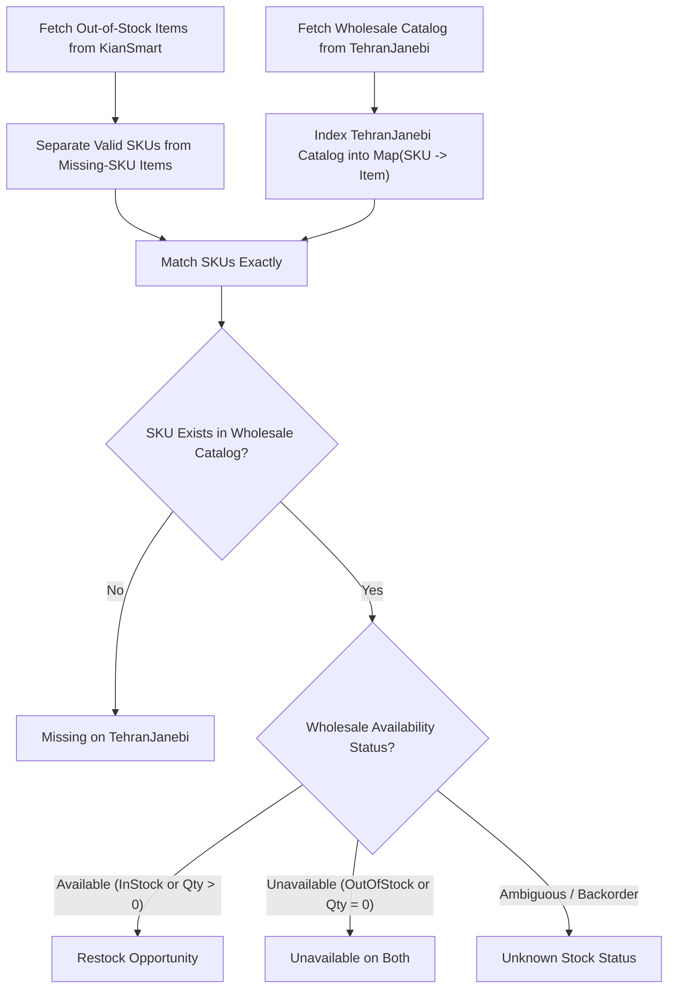

# Inventory Reconciliation & Product Automation System
## KianSmart (kiansmart.ir) ⇄ TehranJanebi (tehranjanebi.com)

---

## 1. System Overview

This repository hosts two decoupled, production-grade e-commerce automation subsystems:

1. **Product Publishing Automation**: Scrapes product specifications, images, and attributes from TehranJanebi (custom-coded Vue/Nuxt) or WordPress/WooCommerce websites, and publishes them as products into KianSmart's WooCommerce store.
2. **Inventory Reconciliation Subsystem**: A one-click dashboard that checks out-of-stock products on KianSmart, extracts their SKUs, compares them against TehranJanebi's wholesale catalog, and isolates immediate restock opportunities.

> [!IMPORTANT]
> **Safety Guarantee — 100% Read-Only Reconciliation**  
> The reconciliation subsystem strictly performs read-only queries against both KianSmart and TehranJanebi. It never mutates database records, never alters inventory stock counts, and never places automated orders or purchases. All actions are prepared for manual human review.

---

## 2. Professional Directory Architecture

The repository is organized following clean architectural boundaries under the `src/` directory. Redundant root-level scripts have been removed, leaving only the primary CLI entry points and configuration files at the root level.

```text
autoPostWp/
├── src/                                  # Primary Application Source Code
│   ├── clients/                          # External Integration Clients
│   │   ├── woocommerce-client.js         # KianSmart read-only client (pagination, variations, SKUs)
│   │   └── tehranjanebi-client.js        # TehranJanebi client & adapter (backoff, timeouts, batching)
│   │
│   ├── core/                             # Pure Domain & Business Logic
│   │   └── comparison-engine.js          # Deterministic O(N+M) SKU reconciliation engine
│   │
│   ├── dashboard/                        # Web Dashboard Server & Frontend UI
│   │   ├── server.js                     # Native Node.js HTTP server (zero extra dependencies)
│   │   └── public/                       # Frontend Single Page Application (SPA)
│   │       ├── index.html                # Multi-view layout (Reconciliation & Publisher)
│   │       ├── style.css                 # Polished, responsive design system
│   │       └── app.js                    # View switching, search, sorting, CSV export, publishing
│   │
│   ├── publisher/                        # Product Scraper & Uploader Automation
│   │   ├── scraper.js                    # Puppeteer router and site-type detector
│   │   ├── scraper-custom.js             # TehranJanebi custom DOM parser & feature extractor
│   │   ├── scraper-wordpress.js          # WordPress / WooCommerce DOM parser
│   │   └── uploader.js                   # WooCommerce REST API product publisher
│   │
│   └── utils/                            # Shared Utilities
│       ├── image-processor.js            # Sharp-based image optimization & watermark processing
│       ├── image-uploader.js             # WordPress media library uploader
│       └── logger.js                     # Safe logger with automatic credential & token redaction
│
├── tests/                                # Automated Test Suites (Native Node Test Runner)
│   ├── comparison-engine.test.js         # SKU exact match, null quantities, duplicate detection
│   ├── woocommerce-client.test.js        # WooCommerce pagination, variations, 401 auth, timeouts
│   └── tehranjanebi-client.test.js       # TehranJanebi batch pagination, backoff retries, errors
│
├── main.js                               # CLI entry point for the product publisher
├── package.json                          # Scripts: start, dashboard, test, install:browser
├── .env                                  # Environment secrets (preserved, never logged or committed)
├── .env.example                          # Documented environment template with adapter settings
├── RECONCILIATION_DOCS.md                # Comprehensive system documentation
└── README.md                             # Repository overview and quick start guide
```

---

## 3. Environment Configuration (`.env`)

The project reuses the existing `.env` file without overwriting any values.

### Standard Credentials:
- `WOOCOMMERCE_URL`: KianSmart WooCommerce store URL (`https://kiansmart.ir`).
- `WOOCOMMERCE_CONSUMER_KEY`: Read/Write WooCommerce REST API Consumer Key.
- `WOOCOMMERCE_CONSUMER_SECRET`: WooCommerce REST API Consumer Secret.
- `WP_API_USER`: WordPress username for media uploads.
- `WP_API_APP_PASSWORD`: WordPress Application Password for media uploads.
- `CUSTOM_SITE_BASE_URL`: TehranJanebi base URL (`https://www.tehranjanebi.com`).

### Optional Reconciliation & Dashboard Settings:
Documented in [`.env.example`](file:///c:/Users/keyhan/Documents/WindowsPowerShell/autoPostWp/.env.example):
- `DASHBOARD_PORT`: Local web dashboard port (defaults to `3000`).
- `DASHBOARD_HOST`: Local binding interface (defaults to `127.0.0.1` for local safety).
- `TEHRANJANEBI_API_BASE_URL`: Optional custom API host if distinct from the web portal.
- `TEHRANJANEBI_PRODUCTS_ENDPOINT`: Products endpoint path (defaults to `/api/products`).
- `TEHRANJANEBI_API_KEY`: Optional `X-API-KEY` header for authenticated wholesale endpoints.
- `TEHRANJANEBI_AUTH_TOKEN`: Optional Bearer authentication token.
- `TEHRANJANEBI_SNAPSHOT_FILE`: Optional local JSON snapshot file for offline reconciliation.
- `TEHRANJANEBI_TIMEOUT_MS`: Request timeout in milliseconds (default: `15000`).
- `TEHRANJANEBI_MAX_RETRIES`: Maximum retries on 429/50x transient errors (default: `3`).

---

## 4. Operational Commands

### 1. Launch the Control Panel Dashboard
```bash
npm run dashboard
```
Access the interactive web UI at: **`http://127.0.0.1:3000`**

### 2. Run the Publisher via Command Line
```bash
node main.js <product_url>
```
*Example:*
```bash
node main.js https://www.tehranjanebi.com/product/PSH954-ProOne-Rechargeable-Shaver/
```

### 3. Run the Automated Test Suite
```bash
npm test
```
Executes all 17 automated tests verifying comparison logic, API timeouts, variations, and retry mechanisms.

---

## 5. Inventory Reconciliation Subsystem

### Comparison Engine Pipeline ($O(N + M)$ Complexity)



### Business Rules & Edge Case Handling:
1. **Safe SKU Normalization**: Surrounding whitespace is trimmed (`sku.trim()`), but casing and leading zeroes (e.g. `"00789"`) are strictly preserved.
2. **Variable Products & Variations**: If a product is of type `variable`, each out-of-stock variation is inspected and evaluated individually by variation SKU.
3. **Explicit Quantities vs. Unspecified**: If TehranJanebi confirms an item is in stock but provides no numerical quantity, it is listed as `Available (Unspecified Quantity)` with a `null` quantity—never assumed to be zero.
4. **Duplicate SKU Detection**: Duplicate SKUs on either platform are tracked and reported in duplicate registers.
5. **Fault Containment**: A network timeout or HTTP error from either upstream API immediately aborts with a descriptive error; it is **never** treated as an empty inventory.

---

## 6. Multi-URL Batch Product Publisher

The dashboard includes a dedicated **Product Publisher** view:
- **Batch Input**: Paste multiple product URLs into a single textarea (one URL per line).
- **Format Validation**: Automatically trims and validates URL structures.
- **Automated Workflow**: Sequentially triggers the Puppeteer scraper (`scrapeProduct`) followed by the WooCommerce uploader (`uploadProduct`).
- **Live Output Table**: Reports the created WooCommerce Product ID, price, SKU, attached images count, and direct link to the product or error message.

---

## 7. Automated Test Verification

All 17 test cases pass using Node.js's native test runner (`node --test`):
- `tests/comparison-engine.test.js`: Matching SKUs, unavailable on both, missing from wholesaler, duplicate records, null quantities, empty product arrays, whitespace normalization with leading zeroes, and unknown statuses.
- `tests/woocommerce-client.test.js`: Multi-page pagination, variable product variation parsing, 401 unauthorized handling, and request timeouts.
- `tests/tehranjanebi-client.test.js`: Wholesale batch pagination, 401 auth rejection, transient 502 retries with exponential backoff, and network failure containment.
